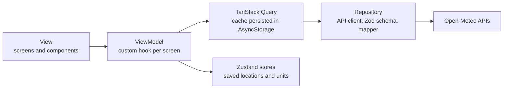

# WeatherApp

A weather app for Android, built with plain React Native (no Expo) and TypeScript. It shows current conditions, a 48-hour forecast and a 7-day forecast for your location or any city you search for, and keeps showing the last fetched data when you are offline.

This is a portfolio project. It is not published to any app store. A prebuilt APK is available on the [Releases](https://github.com/rayennnc/weather-app/releases) page.

[](https://github.com/rayennnc/weather-app/actions/workflows/ci.yml)

## Features

- Current weather: temperature, condition, feels-like, humidity, wind and precipitation
- Hourly forecast (next 48 hours) and daily forecast (7 days, with sunrise, sunset and UV index)
- Device location (approximate, requested only when you ask for it) with a city search fallback, plus saved locations
- Unit settings: °C/°F and km/h or mph
- Offline support: the last data stays visible for up to 7 days with an "Updated" label, and refreshes when the app returns to the foreground
- Loading, error, empty and permission-denied states
- Light and dark theme that follow the system
- Screen reader support (TalkBack): grouped rows and labeled icon buttons
- An About screen that credits the data sources and icons

## Tech stack

- React Native 0.88 (Community CLI, New Architecture) and TypeScript (strict)
- React Navigation 7 (native stack)
- TanStack Query 5 with a persisted cache (AsyncStorage) for server state
- Zustand with persistence for saved locations and units
- Zod 4 for validating API responses
- Material Design Icons through `@react-native-vector-icons`
- Jest and React Native Testing Library, ESLint and Prettier
- GitHub Actions (lint, type check, format check, test)
- Weather data from [Open-Meteo](https://open-meteo.com/), which needs no API key

## Architecture

MVVM with hooks, organized by feature:

- **View**: screens and components. They only render and call callbacks.
- **ViewModel**: one custom hook per screen. It combines server state and UI state, and exposes data that is ready to display (`loading`, `error` or `success`).
- **Model**: repository, API client, Zod schema and mapper. Components never see raw API JSON.



```text
src/
  app/          app shell: App.tsx, navigation/, providers/ (query client, cache persistence)
  features/
    weather/    data/ hooks/ ui/    current, hourly and daily forecast
    search/     data/ hooks/ ui/    city search (Open-Meteo Geocoding)
    locations/  data/ hooks/ ui/    saved locations and device location
    settings/   hooks/ ui/          units and the About screen
  shared/       i18n/ lib/ stores/ theme/ types/ utils/
```

Imports only flow in one direction: `shared` → `features` → `app`. Screens never call the navigator. Each screen receives callbacks and `app/navigation` wires them together, so features do not import each other.

## Design decisions

- **Offline first.** The forecast query is persisted to AsyncStorage and stays visible for up to 7 days, with an "Updated" label. A failed refresh keeps the old data on screen instead of replacing it with an error. The app refetches stale data when it returns to the foreground.
- **Location time, not phone time.** All times are shown in the timezone of the place, using the offset from the API. "Now" and "Today" are computed from that offset whenever the screen is drawn.
- **Validation at the boundary.** Every API response goes through a Zod schema and a mapper, so components only see typed, display-ready data.
- **Privacy.** Only approximate location is requested, and only when you tap "Use my location". Coordinates are sent only to Open-Meteo. There are no accounts and no analytics.
- **Native code behind one file.** The geolocation library is touched only in `deviceLocationRepository.ts`, so it can be replaced without changing the rest of the app.
- **Theming and accessibility.** Colors come from palette tokens, and tests keep every text and background pair at a contrast ratio of at least 4.5:1 in both themes.
- **Ready for translation.** All UI text goes through a typed dictionary (`shared/i18n`). Only English exists today.

## Testing

More than 400 tests run with Jest and React Native Testing Library:

- mappers, formatters and repositories (with a mocked `fetch`), plus contract tests against recorded API responses
- ViewModels with mocked repositories and a fresh query client per test
- screens in their loading, error and data states, plus light and dark mode checks for each screen
- date and time formatters under several time zones

`npm run check` runs lint, type check, format check and the tests, the same steps as CI.

## Getting started

Prerequisites:

- Node.js 22.11 or newer (CI uses 24 LTS)
- JDK 17
- Android Studio with Android SDK Platform 37, Build-Tools 37.0.0 and NDK 27.1.12297006
- An Android emulator, or a device with USB debugging

See the [React Native environment setup guide](https://reactnative.dev/docs/set-up-your-environment) for details. On Windows, keep the project path short, because native builds can fail on paths longer than 260 characters.

```sh
git clone https://github.com/rayennnc/weather-app.git
cd weather-app
npm ci
npm start
# in a second terminal
npm run android
```

## Scripts

| Command                | Description                                          |
| ---------------------- | ---------------------------------------------------- |
| `npm start`            | Start the Metro development server                   |
| `npm run android`      | Build and run the Android app                        |
| `npm run check`        | Lint, type check, format check and test (same as CI) |
| `npm run lint`         | Run ESLint                                           |
| `npm run typecheck`    | Run the TypeScript compiler without emitting files   |
| `npm run format:check` | Check formatting with Prettier                       |
| `npm run format`       | Format all files with Prettier                       |
| `npm test`             | Run Jest tests                                       |

## Release build

To build an installable APK for ARM phones (32-bit and 64-bit):

```sh
cd android
./gradlew assembleRelease "-PreactNativeArchitectures=armeabi-v7a,arm64-v8a"
```

On Windows PowerShell, use `.\gradlew`. The APK is written to `android/app/build/outputs/apk/release/app-release.apk`.

### Signing

From v1.0.1 on, the APKs on the Releases page are signed with the maintainer's private release key, which is not in this repository. Your own builds work without it: when no release key is configured, Gradle falls back to the standard debug key that comes with the React Native template. That is fine for testing, but not for distribution or the Play Store.

To sign with your own key, create a keystore outside the repository and add these properties to `~/.gradle/gradle.properties`, never to the project:

```properties
WEATHERAPP_RELEASE_STORE_FILE=/path/to/your-release.jks
WEATHERAPP_RELEASE_KEY_ALIAS=your-key-alias
WEATHERAPP_RELEASE_PASSWORD=your-password
```

The same password is used for the keystore and the key, which is the default for PKCS12 keystores. Back the keystore up: without it you cannot publish updates that existing installs will accept. An APK signed with a different key cannot be installed over an older one, so uninstall the previous version first.

## Data sources and credits

- Weather data by [Open-Meteo](https://open-meteo.com/), licensed under [CC BY 4.0](https://creativecommons.org/licenses/by/4.0/). The app rounds the numbers. Open-Meteo's free API is for non-commercial use and has rate limits, see their [terms](https://open-meteo.com/en/terms). If you build on this code commercially, you need their commercial plan or another provider. The repository layer is written so the provider can be swapped.
- Place search uses the Open-Meteo Geocoding API, with place names from [GeoNames](https://www.geonames.org/) (CC BY).
- Icons are [Material Design Icons](https://pictogrammers.com/library/mdi/) by Pictogrammers, licensed under [Apache 2.0](https://pictogrammers.com/docs/general/license).

The About screen in the app credits the same sources.

## Known limitations

- **Android only.** iOS is out of scope for v1 (there was no Mac to build on), so the iOS project is untouched and untested.
- **Daylight saving time.** Open-Meteo returns times with one fixed UTC offset per response, so in cities that observe DST the hour labels can be off by one hour after a DST change. Indonesia has no DST, so the main use case is not affected.
- **Stale "Now" and "Today" labels.** They are recomputed on every render, not on a timer. A screen left open across the change of the hour updates on the next refresh or interaction.
- **English only.** Indonesian is planned.

## Roadmap

Optional, not started: Indonesian translation with a language setting, weather-themed background animations, and an iOS compile check in CI.

## License

[MIT](LICENSE). The license covers this code only. Open-Meteo data, GeoNames place names and the Material Design Icons keep their own licenses and terms, listed above.
